<h1 align="center">rankwise</h1>

<p align="center"><b>Lane-parallel SIMD order statistics.</b> Medians, quantiles, ranks and sigma clipping along one axis of an array:<br>
one SIMD lane per slice, sorted by branch-free networks, with results identical to NumPy, SciPy and astropy.</p>

<p align="center">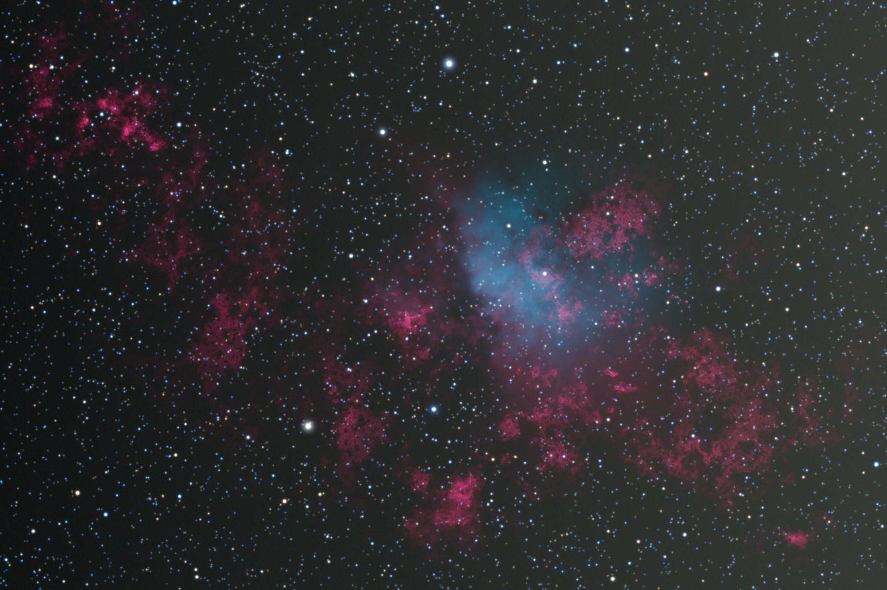</p>

<p align="center"><sub>40 synthetic 30 s subs (1800×1200 RGB) with five satellite trails, an airplane, a meteor, cosmic rays and hot pixels,<br>stacked by <code>rankwise.sigma_clip_mean</code> in 1.1 s on one core, full rejection map included.<br>Every rejection decision is identical to astropy's.</sub></p>

<p align="center">
<b>14× faster sigma clipping</b> · <b>20× faster medians</b> · <b>72× faster ensemble quantiles</b> · <b>21× faster cloud-free composites</b><br>
<sub>than the fastest open-source alternative, per core · quantiles on real NOAA GEFS data, composites on real Landsat scenes · <a href="docs/benchmarks.md">benchmarks</a></sub>
</p>

---

**rankwise** computes order statistics of millions of short slices: the median of 31 frames
for every pixel of a 24-megapixel image, the 10th and 90th percentile of 31 ensemble members
for every cell of a global grid. Libraries vectorize *inside* one slice, which does little
when a slice is 30 values long. rankwise vectorizes *across* slices: register `k` holds frame
`k` of 16 neighbouring pixels (AVX-512), so every min/max instruction advances 16 sorts at
once, and nothing ever branches on pixel values.

It ships as a Rust crate, a C library with a header, and a Python package, and picks
AVX-512, AVX2, NEON or a portable fallback at runtime.

## Python

```python
import numpy as np
import rankwise as rw

stack = np.load("lights_registered.npy", mmap_mode="r")    # (40, 1200, 1800, 3) float32, never copied
out = np.empty(stack.shape[1:], np.float32)                 # caller owns the output
rej = np.empty(stack.shape[1:], np.uint16)

rw.sigma_clip_mean(stack, axis=0, sigma=(3, 3), maxiters=5, out=out, rejected=rej)  # astropy's decisions
med = rw.median(stack, axis=0)                              # identical to np.median, dtype included
lo, hi = rw.quantile(stack, [0.1, 0.9], axis=0)             # identical to np.quantile, every method
trim = rw.trimmed_mean(stack, 0.1, axis=0)                  # scipy.stats.trim_mean
spread = rw.iqr(stack, axis=0)                              # scipy.stats.iqr
k = rw.select_ranks(stack, [0, 3, 36], axis=0)              # any ranks, one pass

frames = [np.load(f, mmap_mode="r") for f in sorted(paths)] # frames in separate buffers work too
rw.sigma_clip_mean(frames, sigma=(3, 3), out=out)
```

Every function follows NumPy's names and conventions (`axis`, `out`, `keepdims`, `method`,
the `nan*` variants) and reduces **any axis** of a float32, float64 or uint16 array without
copying it. Kernels run with the GIL released; `threads=` splits large calls.

<details>
<summary><b>The full Python API</b></summary>

| Function | Same results as |
|---|---|
| `median`, `nanmedian` | `np.median`, `np.nanmedian` |
| `quantile`, `nanquantile`, `percentile`, `nanpercentile` (13 methods) | NumPy, including how `q` is passed and `out=` |
| `min`, `max`, `nanmin`, `nanmax`, `ptp` | NumPy |
| `argmin`, `argmax`, `nanargmin`, `nanargmax` | NumPy (first occurrence) |
| `argmedian`, `nanargmedian`, `argselect` | `np.argsort(kind="stable")` at the rank: which frame supplied the value |
| `select_ranks` | `np.sort(a, axis)[ranks]` |
| `trimmed_mean`, `iqr`, `mad` | `scipy.stats.trim_mean`, `iqr`, `median_abs_deviation` |
| `sigma_clip_mean` | `astropy.stats.sigma_clip(...).mean()`: identical masks |
| `clip_combine(method=...)` | sigma, MAD, median-sigma, winsorized and percentile clipping; `preset="siril"` / `"pixinsight"` |
| `nodata=` (uint16) | missing values skipped, like NaN in the `nan*` functions |
| `scale=`, `offset=`, `weights=` | per-frame normalization and weighting, fused into the same pass |
| `low=`, `high=`, `rejected=`, `mask=` | per-pixel reject counts and the full rejection map |
| `available_isas()`, `set_isa()`, `use_isa()`, `describe()` | dispatch control and introspection |

`xr.apply_ufunc(rw.quantile, ds.tas, 0.9, input_core_dims=[["member"], []], kwargs={"axis": -1}, dask="parallelized")`
works as is: an innermost reduced axis goes through an in-cache transpose.

</details>

## How it works

<p align="center">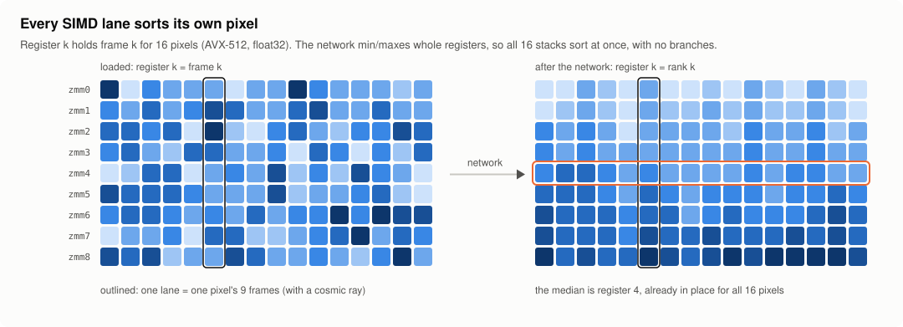</p>

A sorting network is a fixed list of compare-exchanges, and a compare-exchange of two
registers is a `vminps` and a `vmaxps`. rankwise generates Batcher's odd-even merge network,
then **prunes it to the ranks you ask for**: a median of 31 frames needs 152 of 186
comparators; p10/p50/p90 need 162.

<p align="center">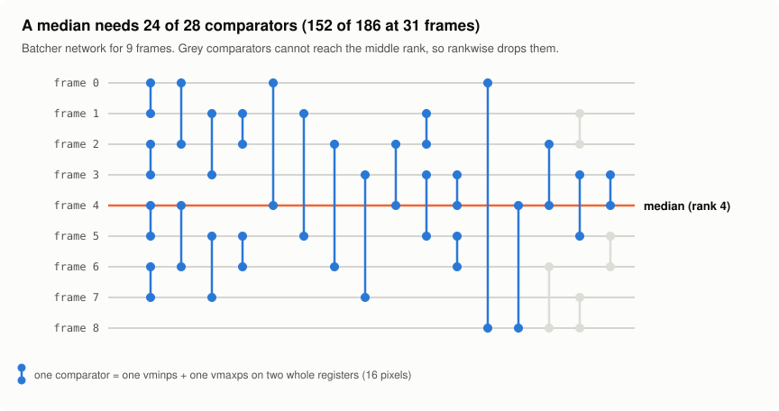</p>

* **Register-resident networks.** For stacks up to 32 deep, `build.rs` emits each network as
  straight-line code, so the whole stack stays in the 32 zmm registers instead of
  round-tripping through L1 after every comparator. Deeper stacks sort 32-wide blocks that way
  and interpret only the remaining merge levels.
* **One kernel, four ISAs.** Kernels are written once against a small vector trait and
  compiled into a `#[target_feature]` function per ISA (AVX-512 with opmask registers, AVX2,
  NEON, portable). `RANKWISE_ISA=avx2` or `rw.set_isa("scalar")` forces one; results are
  identical on all of them.
* **NaN without branches.** One compare per frame detects NaN (or `nodata`). Only blocks
  that have any replace them with +inf and count each lane's valid values, so `nanmedian` and
  `nanquantile` pick per-lane ranks while clean blocks keep the pruned network.
* **Rejection in registers.** Sigma clipping keeps per-lane rank bounds into the sorted
  stack and moves them inward; center, spread and bounds run in float64 like astropy's C code,
  and the last bounds are re-applied to every value exactly as astropy builds its mask.
* **NumPy's arithmetic, not just its algorithm.** Quantile interpolation follows NumPy's
  dtype rules to the bit, including the ones that depend on how `q` was passed and on `out=`
  ([details](docs/conformance.md#numpy-behaviours-rankwise-reproduces)).

More in [docs/design.md](docs/design.md).

## Benchmarks

One core per tool, the same array in RAM for everyone, best of three runs after a warm-up,
and every result checked against its reference ([method and full tables](docs/benchmarks.md)).

<picture>
  <source media="(prefers-color-scheme: dark)" srcset="docs/img/bench_astro_dark.png">
  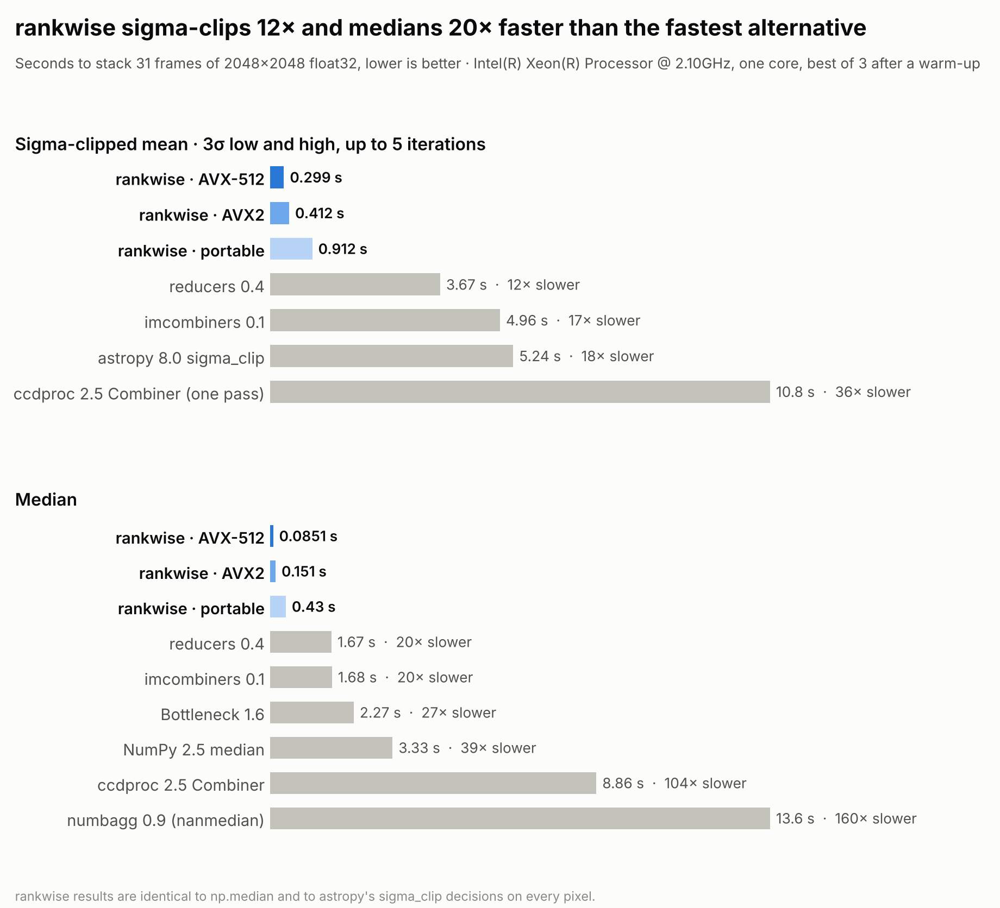
</picture>

<picture>
  <source media="(prefers-color-scheme: dark)" srcset="docs/img/bench_sweep_dark.png">
  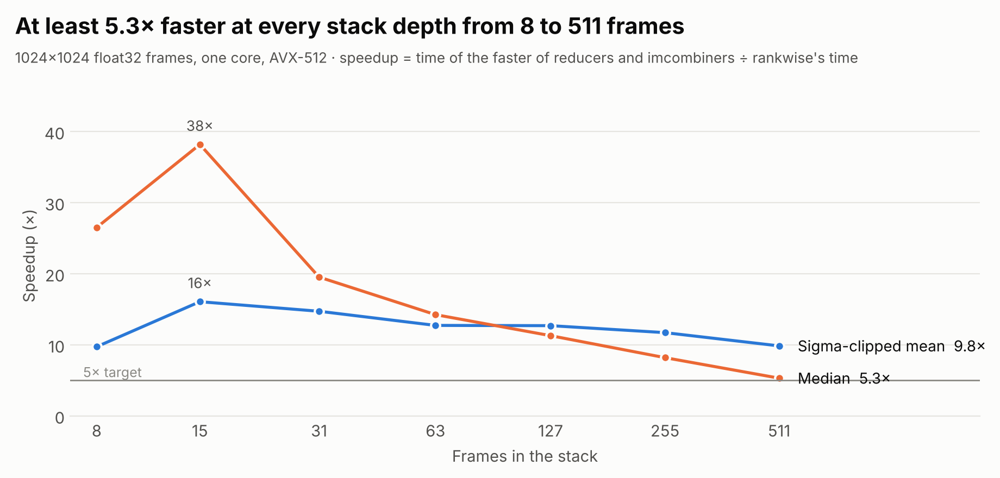
</picture>

<picture>
  <source media="(prefers-color-scheme: dark)" srcset="docs/img/bench_ensemble_dark.png">
  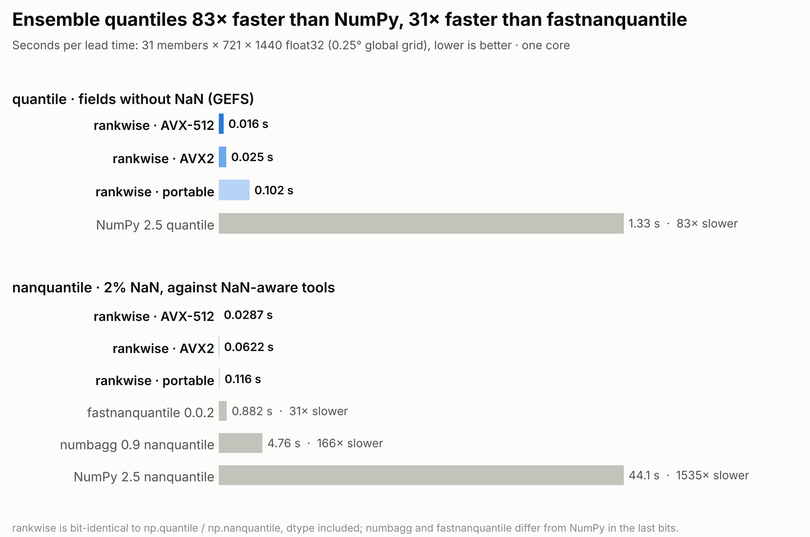
</picture>

Reading the data does not hide the gain: with 31 FITS files read from the page cache first
(0.11 s), rankwise's median takes 0.21 s end to end against 1.7 s for reducers and 2.7 s for
Siril, which does its own reading (`bench/e2e.py`).

Reproduce: `taskset -c 1 python bench/astro.py`, `bench/sweep.py`, `bench/ensemble.py`,
`bench/gefs.py`, `bench/landsat.py`, `bench/e2e.py`, `bench/stride.py`, then
`python bench/figures.py && python bench/report.py` (or `bash bench/run_all.sh`).

## Three case studies

### Astrophotography: rejection you can see

<p align="center">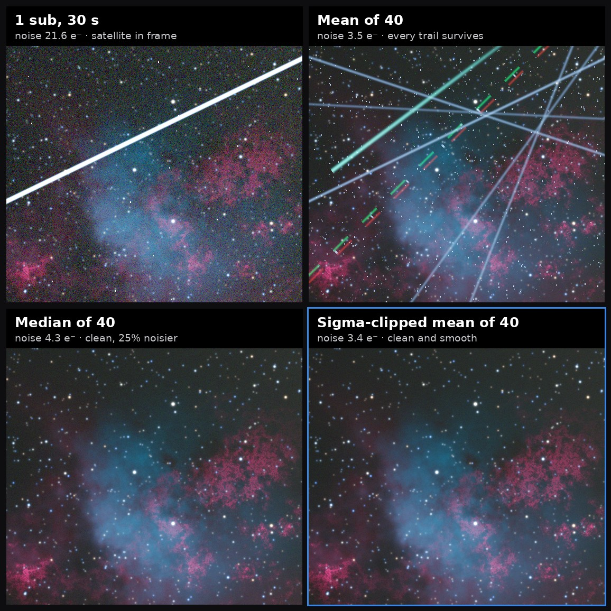</p>

The plain mean is smooth but keeps every trail; the median is clean but 25% noisier; the
sigma-clipped mean is both clean and smooth, with background noise falling from 21.6 e⁻ in one sub
to 3.4 e⁻. The rejection map shows what was removed:

<p align="center">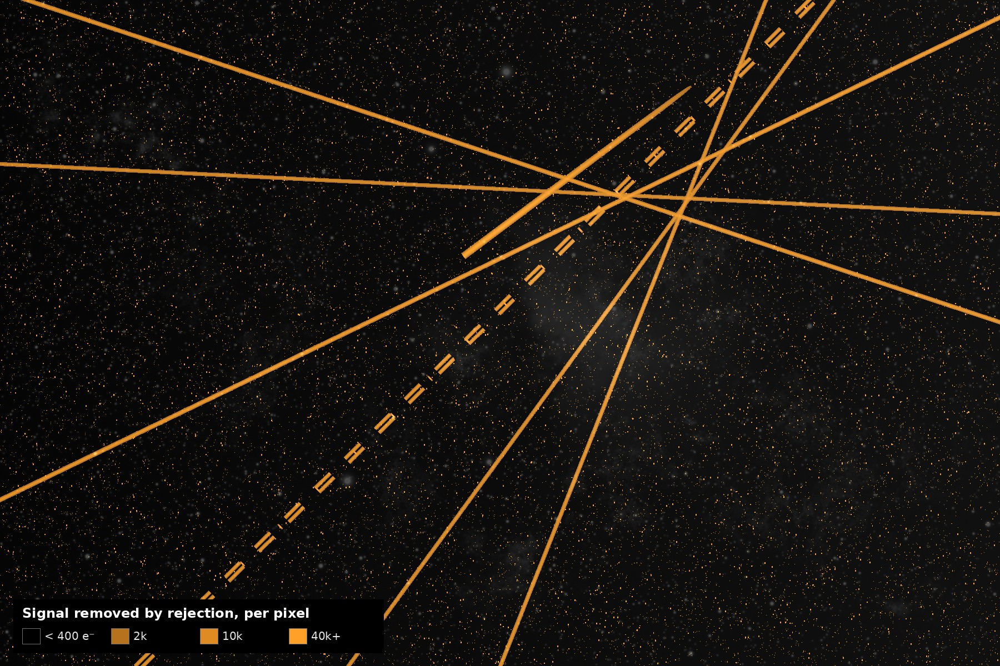</p>

`python examples/python/astro_demo.py` regenerates all three images.

### Weather ensembles: real NOAA GEFS data

<picture>
  <source media="(prefers-color-scheme: dark)" srcset="docs/img/gefs_fan_dark.png">
  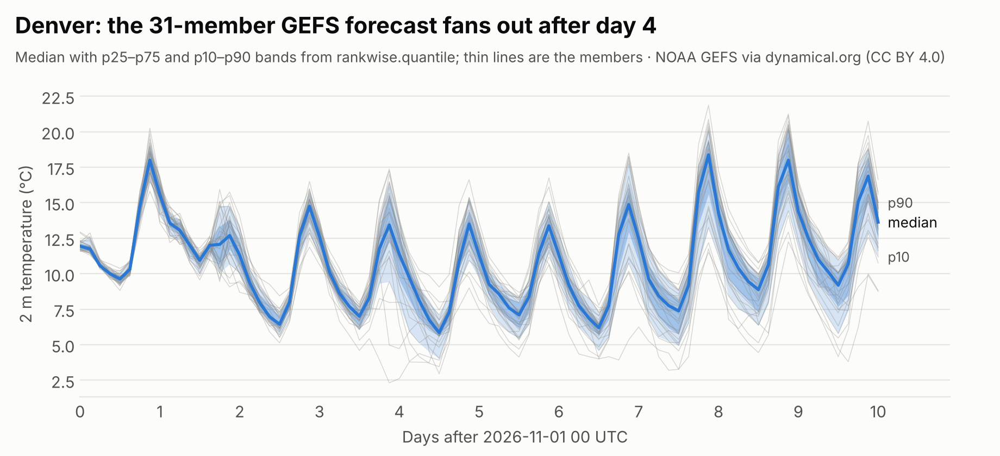
</picture>

<picture>
  <source media="(prefers-color-scheme: dark)" srcset="docs/img/gefs_spread_dark.png">
  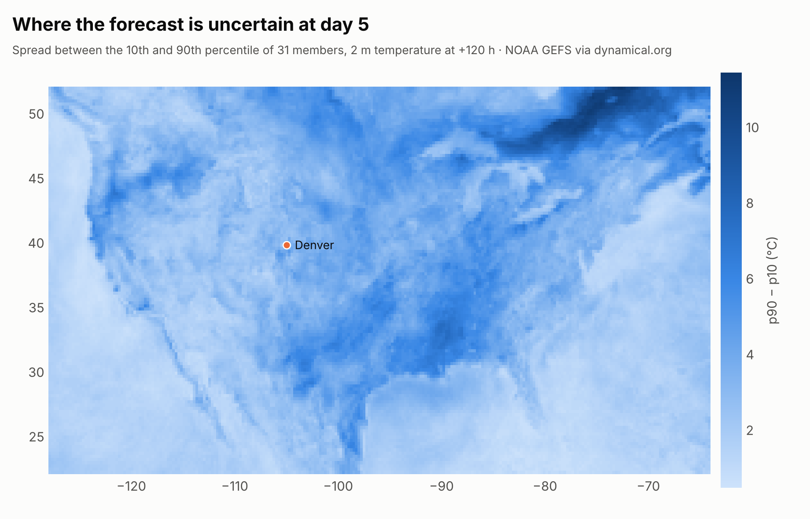
</picture>

One GEFS run over the contiguous US, every member and lead time to 240 h, read from
[dynamical.org](https://dynamical.org/catalog/noaa-gefs-forecast-35-day/) (CC BY 4.0):
p10/p50/p90 of 2.5 million 31-member slices take 0.032 s on one core, bit-identical to `np.quantile`, against 2.3 s for fastnanquantile and 2.6 s for NumPy (`bench/gefs.py`).

### Satellite composites: real Landsat, uint16 with nodata

<p align="center">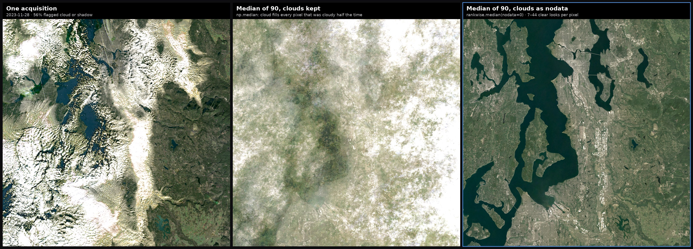</p>

Every Landsat 8 and 9 acquisition of Seattle and Tacoma in 2023 and 2024 (90 scenes,
Collection 2 surface reflectance via Microsoft Planetary Computer), with the pixels QA_PIXEL
flags as cloud, cirrus or shadow set to the fill value 0: 65% of all values. rankwise works
on the integers directly (`rw.median(scenes, axis=0, nodata=0)`, 32 lanes per AVX-512
register): 0.23 s for the 2048×2048 red band on one core, identical to `np.nanmedian`,
against 4.9 s for Bottleneck's float32 `nanmedian` (21×) and 21 s for NumPy
(`bench/landsat.py`).

## Correctness

"Identical" means the same dtype and the same values under IEEE equality, NaN equal to NaN.
The conformance suite runs 1,051 tests on every ISA the CPU has, against pinned NumPy
2.5.3, SciPy 1.18.1 and astropy 8.0.2: every stack depth from 1 to 17 plus 31–33, 63–65,
127–129, 255, 256, 511 and 512; partial vectors; float32, float64 and uint16; every axis,
frame lists, memory maps, negative and power-of-two strides; NaN from none to all-NaN slices,
±inf, ±0, ties, subnormals and ±FLT_MAX; every quantile method and every way of passing `q`.
The Rust networks are checked exhaustively for n ≤ 20 with the 0-1 principle, and the NEON
kernels run on aarch64 in CI.

Siril's sigma, median-sigma and percentile clipping are reproduced exactly (identical reject
maps and stacked values against `siril-cli` 1.2.1); see [presets](docs/presets.md) for
winsorized and for what is not matched yet. Known differences are listed in
[docs/conformance.md](docs/conformance.md#known-differences).

## Rust

```rust
use ndarray::{Array2, ArrayView3, Axis};
use rankwise::{Clip, Reduce};

fn integrate(stack: ArrayView3<f32>) -> rankwise::Result<Array2<f32>> {
    let mut out = Array2::zeros((stack.dim().1, stack.dim().2));
    stack.reduce_into(Axis(0), Clip::sigma(3.0, 3.0).max_iters(5).mean(), out.view_mut())?;
    Ok(out)
}

// Plain slices, one per frame: no ndarray needed
let frames: Vec<&[f32]> = subs.iter().map(|s| s.as_slice()).collect();
rankwise::median_frames(&frames, &mut master_dark)?;
```

The `ndarray` integration is behind the `ndarray` feature; `rayon` runs multi-threaded calls
on rayon's pool. `rankwise::reduce_raw` takes any strided layout.

## C

```c
#include <rankwise.h>

const float *frames[40];                      /* one pointer per registered frame, H*W floats each */
rw_clip clip = rw_clip_sigma(3.0f, 3.0f, /*maxiters*/ 5);
rw_status st = rw_clip_mean_f32(frames, 40, H * W, &clip, out, /*rejected*/ NULL);
```

`rankwise-capi` builds `librankwise.so`/`.dylib`/`.dll` and `librankwise.a`; the header is
[`rankwise-capi/include/rankwise.h`](rankwise-capi/include/rankwise.h) and
[`examples/c`](examples/c) builds a complete stacker (`make -C examples/c`). Errors come back as
`rw_status`; panics never cross the boundary.

## Building

```bash
cargo test --release -p rankwise --features ndarray       # Rust core
cargo build --release -p rankwise-capi                     # C library
pip install maturin && maturin build --release -m rankwise-py/Cargo.toml -o dist
pip install --find-links dist rankwise                     # Python (abi3 wheel, Python >= 3.9)
python -m pytest conformance -q                            # conformance suite
```

Rust 1.89 or later (AVX-512 intrinsics are stable from 1.89); no nightly features.

## Scope of v0.1

Up to 512 frames per call (stream row strips for more pixels); float32, float64 and uint16
(uint8 widened). Not yet: rolling windows and grouped reductions, weighted quantiles, stacks
deeper than 512, linear-fit clipping and generalized ESD, R and Julia bindings. rankwise is a
kernel, not a stacker: no I/O, registration or calibration.

## License

MIT OR Apache-2.0, so GPL tools such as Siril and closed-source stackers can both use it.
Synthetic data in the benchmarks and images is generated by the scripts in this repository;
GEFS data © NOAA via dynamical.org, CC BY 4.0. Landsat imagery courtesy of the U.S. Geological Survey.
