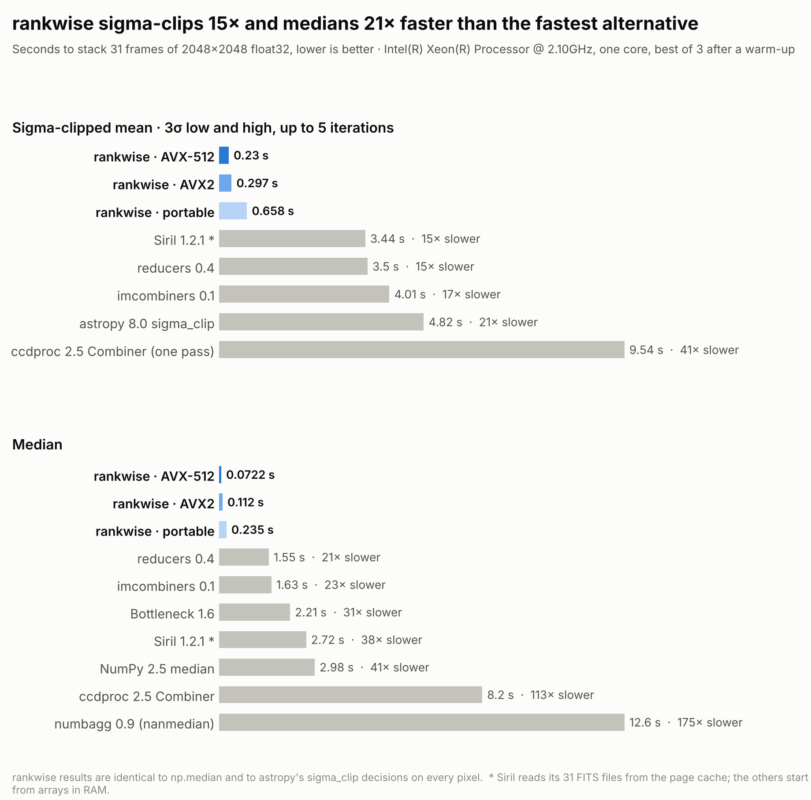
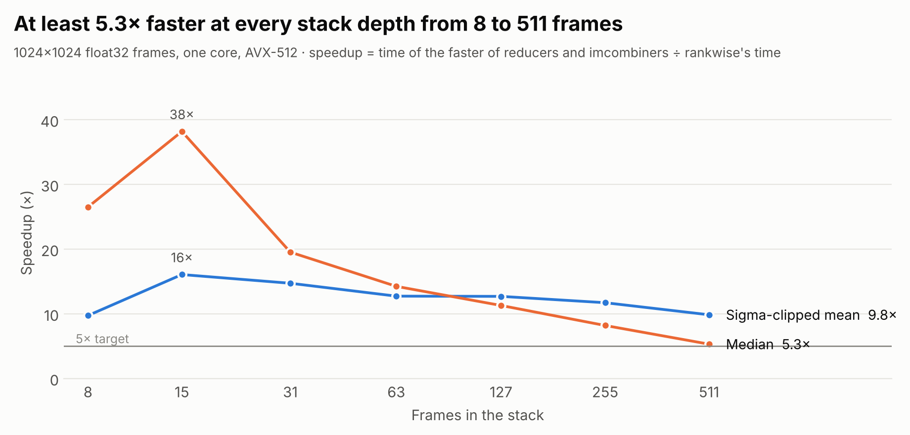
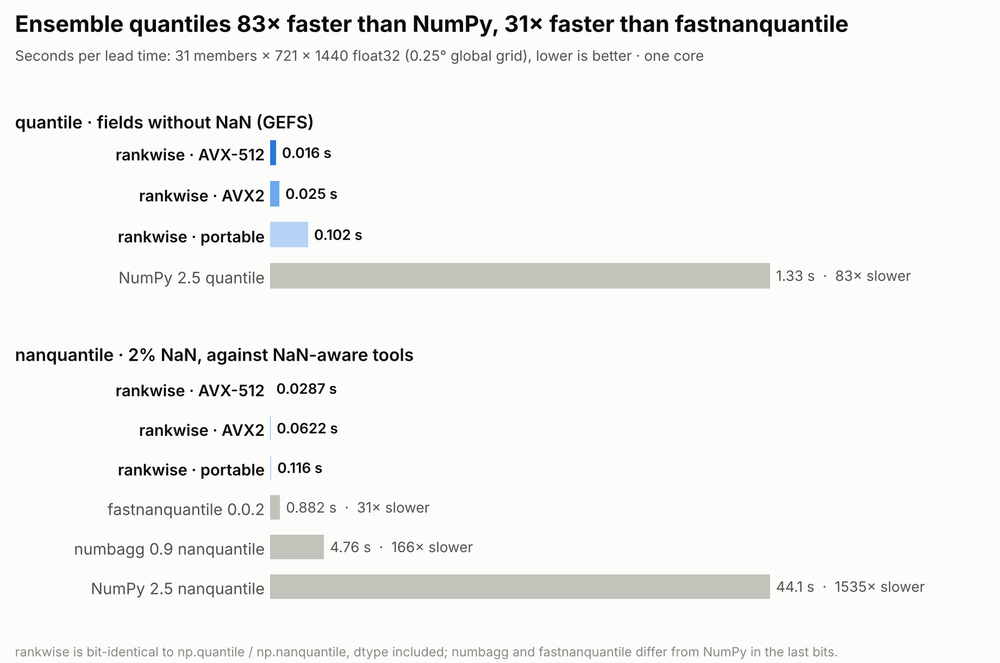
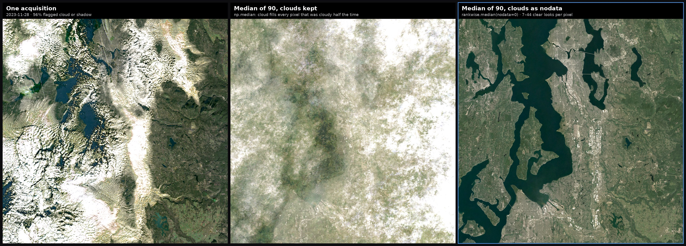
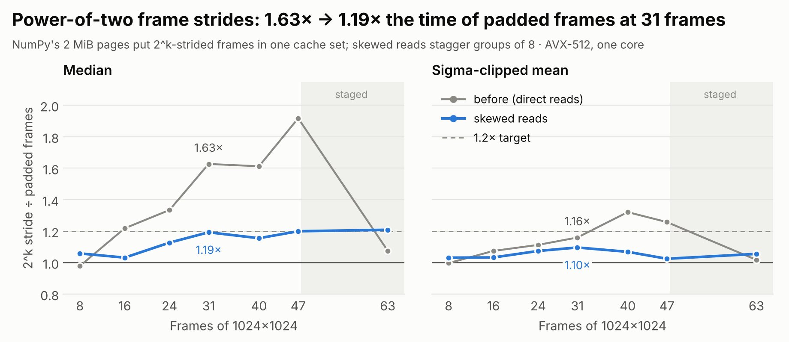

# Benchmarks

Every number here comes from the scripts in [`bench/`](../bench) and the JSON they wrote to [`bench/results/`](../bench/results). Regenerate this page with `python bench/report.py` and the charts with `python bench/figures.py`.

## Method

* **Machine:** Intel(R) Xeon(R) Processor @ 2.10GHz, 4 vCPUs (cloud VM, KVM), ISAs available: avx512, avx2, scalar.
* **One core for every tool.** Scripts run under `taskset -c 1`, and thread pools are pinned with `OMP_NUM_THREADS`, `NUMBA_NUM_THREADS`, `RAYON_NUM_THREADS` and friends set to 1 before any import. rankwise runs with `threads=1`.
* **Same input for everyone.** Each tool gets the same array, already in RAM. Siril reads its own FITS files (from the page cache) and is marked as such.
* **Timing:** best of N runs after a warm-up. rankwise's sub-second runs, which this VM's noise affects most, keep their best over interleaved rounds spread across the measurement (the noise comes in bursts of seconds); other tools take the best of 3, or 2 or 1 for runs of tens of seconds.
* **Every result is checked**, not just timed: medians against `np.median`, quantiles against `np.quantile`/`np.nanquantile`, sigma clipping against astropy's mask.
* **Like for like.** NaN-aware tools are compared with rankwise's NaN-aware functions; ccdproc's `Combiner.sigma_clipping` does a single pass and is labeled so.
* The machine is a shared cloud VM; repeated runs vary by about ±15%.

## Astro stack: 31 × 2048 × 2048 float32

<picture><source media="(prefers-color-scheme: dark)" srcset="img/bench_astro_dark.png"></picture>

| Tool | Operation | Seconds | ns / pixel | vs rankwise AVX-512 | Check |
|---|---|---|---|---|---|
| rankwise · AVX-512 · f32 bounds | sigma-clipped mean | 0.221 | 52.8 | 1.0× | astropy kept counts identical on 100% of pixels |
| rankwise · AVX-512 | sigma-clipped mean | 0.23 | 54.9 | 1.0× | astropy kept counts identical on 100% of pixels |
| rankwise · AVX2 | sigma-clipped mean | 0.297 | 70.8 | 1.3× | astropy kept counts identical on 100% of pixels |
| rankwise · scalar | sigma-clipped mean | 0.658 | 157.0 | 3.0× | astropy kept counts identical on 100% of pixels |
| reducers 0.4 | sigma-clipped mean | 3.5 | 833.4 | 15.8× | mean differs from astropy's by up to 1.9% |
| imcombiners 0.1 | sigma-clipped mean | 4.01 | 955.5 | 18.1× | mean differs from astropy's by up to 1.9% |
| astropy 8.0 sigma_clip | sigma-clipped mean | 4.82 | 1148.4 | 21.8× | mean differs from astropy's by up to 0% |
| ccdproc 2.5 Combiner (1 pass) | sigma-clipped mean | 9.54 | 2274.4 | 43.1× | mean differs from astropy's by up to 49% |
| rankwise · AVX-512 | median | 0.0722 | 17.2 | 1.0× | identical to np.median |
| rankwise · AVX2 | median | 0.112 | 26.7 | 1.5× | identical to np.median |
| rankwise · scalar | median | 0.235 | 56.0 | 3.2× | identical to np.median |
| reducers 0.4 | median | 1.55 | 369.5 | 21.5× | identical to np.median |
| imcombiners 0.1 | median | 1.63 | 389.2 | 22.6× | identical to np.median |
| Bottleneck 1.6 | median | 2.21 | 527.9 | 30.6× | identical to np.median |
| NumPy 2.5 median | median | 2.98 | 710.5 | 41.2× | identical to np.median |
| ccdproc 2.5 Combiner | median | 8.2 | 1954.8 | 113.5× | identical to np.median |
| numbagg 0.9 (nanmedian) | median | 12.6 | 3010.2 | 174.8× | identical to np.median |
| Siril 1.2.1 (reads FITS) | median | 2.72 | 647.4 | — | own I/O |
| Siril 1.2.1 (reads FITS) | sigma-clipped mean | 3.44 | 821.0 | — | own I/O |

reducers and imcombiners clip differently from astropy (they do not re-apply the final bounds to values rejected earlier), so their means differ from astropy's on some pixels. ccdproc runs one pass. The f32-bounds row is rankwise's opt-in float32 center/spread/bounds mode.

## Stack depth sweep: 1024 × 1024 float32

<picture><source media="(prefers-color-scheme: dark)" srcset="img/bench_sweep_dark.png"></picture>

| Frames | rankwise median | rankwise σ-clip | reducers median | imcombiners median | reducers σ-clip | imcombiners σ-clip | NumPy median | median speedup | σ-clip speedup |
|---|---|---|---|---|---|---|---|---|---|
| 8 | 2.8 | 21.1 | 92 | 83 | 187 | 187 | 139 | 29.8× | 8.9× |
| 15 | 5.4 | 28.3 | 205 | 198 | 438 | 471 | 287 | 36.9× | 15.5× |
| 31 | 13.9 | 53.7 | 380 | 357 | 839 | 945 | 753 | 25.6× | 15.6× |
| 63 | 54.6 | 130.3 | 638 | 674 | 1660 | 1905 | 1724 | 11.7× | 12.7× |
| 127 | 109.0 | 284.4 | 1195 | 1198 | 3714 | 3768 | 3392 | 11.0× | 13.1× |
| 255 | 265.6 | 659.4 | 2273 | 2314 | 8055 | 8626 | 6682 | 8.6× | 12.2× |
| 511 | 761.8 | 1815.9 | 4454 | 5001 | 17453 | 18738 | 13882 | 5.8× | 9.6× |

ns per output pixel, one core, AVX-512. Speedup is against the faster of reducers and imcombiners.

## Weather ensemble: p10 / p50 / p90 of 31 members, 721 × 1440

<picture><source media="(prefers-color-scheme: dark)" srcset="img/bench_ensemble_dark.png"></picture>

| Tool | Function | Seconds per lead time | ns / cell | Identical to NumPy |
|---|---|---|---|---|
| rankwise · AVX-512 | quantile | 0.016 | 15.4 | yes |
| rankwise · AVX2 | quantile | 0.025 | 24.1 | yes |
| rankwise · scalar | quantile | 0.102 | 97.9 | yes |
| NumPy 2.5 quantile | quantile | 1.33 | 1283.3 | yes |
| rankwise · AVX-512 | nanquantile | 0.0287 | 27.7 | yes |
| rankwise · AVX2 | nanquantile | 0.0622 | 59.9 | yes |
| rankwise · scalar | nanquantile | 0.116 | 111.6 | yes |
| fastnanquantile 0.0.2 | nanquantile | 0.882 | 850.0 | no |
| numbagg 0.9 nanquantile | nanquantile | 4.76 | 4582.0 | no |
| NumPy 2.5 nanquantile | nanquantile | 44.1 | 42481.5 | yes |

Synthetic GEFS-shaped data (heavy-tailed members in kelvin); the nanquantile rows add 2% NaN. The p10/p50/p90 network keeps 162 of 186 comparators. numbagg and fastnanquantile interpolate differently from NumPy, so their results differ in the last bits.

## Real data: NOAA GEFS 2 m temperature

https://data.dynamical.org/noaa/gefs/forecast-35-day/latest.zarr init 2026-11-01T00, temperature_2m, CONUS, leads 0-240 h (CC BY 4.0); array 31 × 81 × 121 × 257 (members × leads × lat × lon).

| Tool | Seconds | ns / cell | Identical to np.quantile |
|---|---|---|---|
| rankwise · AVX-512 | 0.032 | 12.7 | yes |
| rankwise · AVX2 | 0.0615 | 24.4 | yes |
| rankwise · portable | 0.192 | 76.1 | yes |
| fastnanquantile 0.0.2 | 2.3 | 913.2 | yes |
| NumPy 2.5 quantile | 2.62 | 1041.2 | yes |
| numbagg 0.9 nanquantile | 12 | 4769.5 | yes |

## Real data: Landsat composite, 90 uint16 scenes, 2048 × 2048, clouds as nodata

Landsat C2 L2 SR, WRS-2 046/027, 2023-01-04 to 2024-12-24, via Microsoft Planetary Computer (USGS, public domain). 65% of the red-band values are flagged by QA_PIXEL as cloud, cirrus or shadow and set to the fill value 0. rankwise reads the uint16 data with `nodata=0`; the baselines get float32 with NaN, converted once and not timed.

| Tool | Seconds | ns / pixel | Identical to np.nanmedian |
|---|---|---|---|
| rankwise · AVX-512 (uint16, nodata=0) | 0.231 | 55.2 | yes |
| rankwise · AVX2 (uint16, nodata=0) | 0.325 | 77.5 | yes |
| rankwise · portable (uint16, nodata=0) | 1.07 | 256.0 | yes |
| Bottleneck 1.6 nanmedian (float32) | 4.91 | 1170.7 | yes |
| NumPy 2.5 nanmedian (float32) | 20.6 | 4900.8 | yes |
| numbagg 0.9 nanmedian (float32) | 20.7 | 4944.0 | yes |

## End to end: read 31 FITS files, then stack

The same 31 float32 FITS files of 2048 × 2048 (the astro set), from the page cache. The Python pipelines read them with astropy.io.fits (memmap, byte-swapped) into one array, then reduce it; Siril reads them itself. Seconds:

| Tool | Operation | Read | Reduce | Total | vs rankwise |
|---|---|---|---|---|---|
| rankwise · AVX-512 | median | 0.113 | 0.0963 | 0.209 | 1.0× |
| reducers 0.4 | median | 0.113 | 1.61 | 1.73 | 8.3× |
| Siril 1.2.1 | median | own I/O | — | 2.72 | 13.0× |
| rankwise · AVX-512 | sigma-clipped mean | 0.113 | 0.247 | 0.359 | 1.0× |
| Siril 1.2.1 | sigma-clipped mean | own I/O | — | 3.44 | 9.6× |
| reducers 0.4 | sigma-clipped mean | 0.113 | 3.37 | 3.48 | 9.7× |

Reading takes 0.11 s, longer than rankwise's median itself, so end to end rankwise is 8× faster than reducers for the median and 10× for sigma clipping, rather than the kernel-only ratios above.

## Power-of-two strides

A contiguous stack of 2^k-byte frames puts every frame's current cache line in the same set; NumPy's 2 MiB pages keep that conflict in L2. rankwise reads 8–47 such frames skewed and 48 or more through its tile ([design](design.md#memory-layout-deep-stacks-and-the-power-of-two-stride)). rankwise AVX-512, ns per pixel, best of four interleaved rounds.

<picture><source media="(prefers-color-scheme: dark)" srcset="img/bench_stride_dark.png"></picture>

31 frames:

| Frame | Stride | Read path | Median | Sigma clip |
|---|---|---|---|---|
| 1024x1024 | exactly 2^k | skewed | 13.8 | 52.5 |
| 1024x1024 | +64 B | direct | 11.1 | 48.2 |
| 1024x1024 | +4096 B | direct | 12.9 | 47.9 |
| 2048x2048 | exactly 2^k | skewed | 17.6 | 53.3 |
| 2048x2048 | +64 B | direct | 14.8 | 50.7 |
| 2048x2048 | +4096 B | direct | 13.7 | 52.0 |
| 721x1440 | not 2^k | direct | 12.2 | 49.2 |
| 721x1440 | +64 B | direct | 12.0 | 48.7 |
| 721x1440 | +4096 B | direct | 11.5 | 49.4 |

1024 × 1024 frames by depth, exactly 2^k against +64 B:

| Frames | 2^k path | 2^k median | padded median | ratio | 2^k σ-clip | padded σ-clip | ratio |
|---|---|---|---|---|---|---|---|
| 8 | skewed | 3.0 | 2.8 | 1.06× | 21.2 | 20.5 | 1.03× |
| 16 | skewed | 5.2 | 5.1 | 1.03× | 29.1 | 28.2 | 1.03× |
| 24 | skewed | 10.5 | 9.3 | 1.13× | 41.4 | 38.6 | 1.07× |
| 31 | skewed | 13.5 | 11.3 | 1.19× | 53.6 | 48.9 | 1.10× |
| 40 | skewed | 22.1 | 19.1 | 1.16× | 76.3 | 71.4 | 1.07× |
| 47 | skewed | 30.0 | 25.0 | 1.20× | 91.8 | 89.6 | 1.02× |
| 63 | staged | 46.5 | 38.5 | 1.21× | 132.2 | 125.3 | 1.06× |

