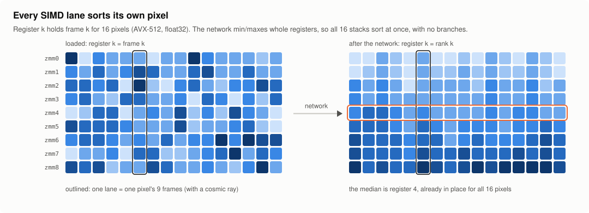
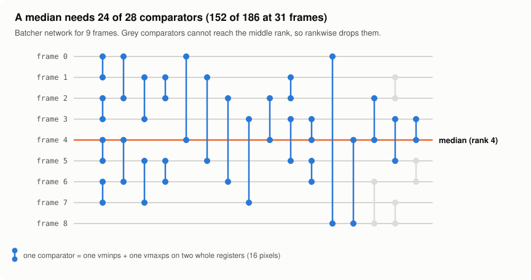

# Design and design log

rankwise reduces one axis of an array by giving every SIMD lane its own slice. This page
explains how the kernel is put together and records where each algorithm came from.

## The one idea

A reduction like "median of 31 frames, per pixel" is millions of short, independent
problems. rankwise loads frame `k` of 16 neighbouring pixels into register `k` (AVX-512,
float32), so lane `j` of registers `0..n` is pixel `j`'s whole stack. A sorting network is a
fixed sequence of compare-exchanges, and a compare-exchange of two registers is one `vminps`
and one `vmaxps`: it advances all 16 stacks at once and never branches on pixel values.

Lanes per register:

| dtype | AVX-512 | AVX2 | NEON | portable |
|---|---|---|---|---|
| float32 | 16 | 8 | 4 | 8 |
| float64 | 8 | 4 | 2 | 4 |
| uint16 | 32 | 16 | 8 | 16 |

## Pipeline per block of lanes

1. **Plan** (once per call, `plan.rs`). Validate shapes, strides, dtypes and parameters;
   resolve the ISA; collapse the non-reduced dimensions into rows of pixels; build the
   networks and, for quantiles, NumPy's index/weight table for every possible valid count.
2. **Load** `n` vectors (`engine.rs`). Frames with unit pixel stride are read in place; any
   other layout (the reduced axis innermost, as `xr.apply_ufunc` produces, or a dtype that
   must widen) goes through an in-cache tile. Per-frame `x * scale[k] + offset[k]` is applied
   here, two roundings, the same on every ISA.
3. **Missing values.** One compare per frame ORs a NaN (or non-finite, or `nodata`) mask.
   Only when a block has any does a second pass replace them with +inf and count each lane's
   valid values `m`. A real +inf stays valid because `m` comes from the mask, not the values.
4. **Sort or select** (`net.rs`). Blocks without missing values run the network pruned to
   the ranks the operation needs; blocks with missing values, where each lane may need
   different ranks, run the full network and gather lane by lane.
5. **Epilogue** (`engine.rs`, `clip.rs`). Median, quantiles, IQR, MAD, trimmed mean,
   arg-variants or rejection; then outputs are written in their dtype with one rounding.

Min, max, range and argmin/argmax skip the network: they are one streaming pass.

## Networks

* **Batcher odd-even merge sort** (K. E. Batcher, "Sorting networks and their applications",
  AFIPS 1968), generated for the next power of two and restricted to the real wires.
* **Rank pruning.** A backwards liveness pass drops every comparator that cannot reach a
  requested output: 152 of 186 comparators for a median of 31 frames, 1,206 of 1,464 at 127.
  Removing a dead comparator never changes a live output, whatever ran before it, which is
  what lets the next point work.

* **Register-resident networks.** `build.rs` emits each network for n ≤ 32 as straight-line
  code over local variables. Inlined into a `#[target_feature]` function, the whole stack
  lives in the 32 zmm registers. The prototype interpreted a comparator list over a buffer in
  L1, which cost two loads and two stores per comparator; this alone made the median 2.5×
  faster than the prototype.
* **Hybrid networks for deep stacks.** Batcher's first log2(32) merge levels sort each
  aligned block of 32 wires independently, so for n > 32 rankwise sorts each block with the
  register-resident network and then interprets only the remaining (pruned) merge levels.
* **Bitonic merges for MAD.** The deviations |x − median| of an already sorted stack fall,
  then rise: a bitonic (valley) sequence, which a half-cleaner cascade of n/2·log2 n
  comparators sorts. That is how both `mad()` and MAD-based clipping avoid a second full sort.

The 0-1 principle tests (`rankwise/tests/networks.rs`) check every network exhaustively for
n ≤ 20: full sorts, pruned selections and the bitonic merger.

## SIMD and dispatch

* `simd/` defines a small `Vector` trait (load, store, min, max, add, sub, mul, compare,
  select, NaN/non-finite masks) with implementations for AVX-512 (F/BW/DQ/VL, opmask
  registers), AVX2, NEON and a portable array fallback. Kernels are generic over it and
  `#[inline(always)]`; `arch.rs` instantiates them inside one `#[target_feature]` function
  per ISA and dtype, so every intrinsic inlines into code compiled for that ISA. No nightly.
* The ISA is chosen per call: an explicit request, else `rankwise.set_isa()` /
  `rw_set_isa()`, else the `RANKWISE_ISA` environment variable (`scalar`, `avx2`, `avx512`,
  `neon`, `auto`), else the fastest the CPU supports (`is_x86_feature_detected!`). The test
  suites force every available ISA.
* **Determinism.** Results are identical across ISAs and thread counts: selections are
  exact; sums use four accumulators keyed by rank (`k % 4`), the same order on every ISA; no
  FMA anywhere. Signed zeros compare equal, but their sign bit can differ between ISAs
  (x86 `minps` and NEON `fmin` order −0 and +0 differently).
* **Threads.** The core is single-threaded over a range of pixels; `threads=` splits rows
  and pixel ranges across rayon's global pool (Python wheel; at most `min(threads, pool size)`
  at once, the pool sized to the visible CPUs or `RAYON_NUM_THREADS`) or up to `threads`
  scoped threads (plain Rust, C).

## Rejection

`clip.rs` keeps per-lane rank bounds `[lo, hi)` into the sorted stack. Each pass computes the
center (a lane-by-lane gather of the middle ranks), the spread (masked sums over the
registers, two-pass std) and the bounds, then walks each lane's bounds inward from the ends
(rejections are few, so this is usually zero or one step). Lanes stop independently; the
block stops when every lane has. In astropy mode the last bounds are re-applied to every
finite value, exactly as `astropy.stats.sigma_clip(..., axis=...)` builds its mask.

Weighted means and the rejection map re-scan the unsorted block, still in L1: because every
v0.1 rejection decides by value, "kept" is exactly `v_lo <= x <= v_hi`, so frame identity
never has to ride through the network.

Precision: center, spread and bounds run in float64 by default, as astropy's C code does.
`precision="f32"` runs them in float32: about 15% faster on this machine, and decisions can
differ from astropy where a value sits within rounding of a bound (1 pixel in 4.2 M in the
benchmark).

## Memory layout, deep stacks and the power-of-two stride

The direct path streams `n` frames at once, one cache line per frame per block. Two things
break that:

* **Deep stacks.** More concurrent streams than the hardware prefetchers track leave the
  loads latency-bound. From 96 frames rankwise copies each frame's next run of pixels
  (768 KiB of tile for all frames together) into an L2-resident tile, one frame at a time,
  and runs the kernel on the tile: 1.7–1.9× faster at 127 frames.
* **Power-of-two frame strides.** A contiguous stack of 1024×1024 or 2048×2048 float32
  frames puts frame starts 4 or 16 MiB apart, so the `n` lines one block needs all map to the
  same cache set, and the lines the prefetchers fetch ahead for one stream evict another's.
  L2 is physically indexed, so how bad this is depends on the page size: NumPy madvises
  large arrays onto 2 MiB pages, which keeps the conflict (31 frames of 1024×1024: 1.6× the
  time of frames padded by one cache line), while 4 KiB pages scatter most of it.
  rankwise counts how many frames start in one L2 set and picks a read path:
  * **8–47 frames: skewed reads.** Frames are split into groups of 8, and group `g` is read
    `g` cache lines ahead of the block being sorted, so at most 8 streams share a set at any
    moment. Each lead load goes straight into a slot-major ring (slot `i` holds block `i` of
    every frame, contiguous) and the network sorts the slot in place, so skewing adds no
    copy; each slot also carries the OR of its missing-value masks. Of group sizes 4, 6, 8,
    12 and one frame per group, 8 was the best or within noise of it at every depth.
  * **48 frames and up: the staging tile.** Skewed and staged reads tie at 63 frames and
    staging wins beyond (more streams than the prefetchers track, see above).

  Time on 2^k strides ÷ time on frames padded by 64 bytes:

  | Frames (1024×1024, 2 MiB pages) | 8 | 16 | 24 | 31 | 40 | 47 | 63 |
  |---|---|---|---|---|---|---|---|
  | median, previous build (direct reads) | 0.98 | 1.22 | 1.33 | 1.63 | 1.61 | 1.92 | 1.08 |
  | median, skewed reads | 1.06 | 1.03 | 1.13 | 1.19 | 1.16 | 1.20 | 1.21 |
  | sigma clip, skewed reads | 1.03 | 1.03 | 1.07 | 1.10 | 1.07 | 1.02 | 1.06 |

  (63 frames are staged in both builds.) Skewed reads of cache-resident data cost the same as
  direct ones, so the remaining 2–21% is on the memory side (each ratio
  is the best of four interleaved rounds on a noisy VM). With 4 KiB pages
  a 1.3× gap at 31 frames remains that skewing does not touch; its cause is not identified
  (no hardware counters on this VM). Padding frames by 64 bytes when you allocate them is
  still the fastest layout.

Both thresholds were measured on a 2 MiB-L2 Sapphire Rapids-class core
([benchmarks](benchmarks.md#power-of-two-strides)). `Staging::{Never, Always, Skew}` in Rust
(`staging="never"|"always"|"skew"` in Python's `describe()`) force a path, `describe()` shows
the one chosen, and `RANKWISE_TILE_BYTES` sets the tile size, for measuring other CPUs;
`cargo run --release --example stridebench` reproduces the table with 2 MiB pages from Rust.

## Errors

Everything is validated before a kernel runs. Rust returns `rankwise::Result`, C returns
`rw_status` (with `catch_unwind` at every entry point, so no panic crosses the FFI), Python
raises `ValueError` / `TypeError`. Lanes that end up with no valid values produce NaN (floats),
the `nodata` value (integer outputs) or −1 (arg-variants), and Python warns like NumPy.

## Design log: provenance

| Piece | Source |
|---|---|
| Batcher odd-even merge sort, bitonic half-cleaners | Batcher 1968 (public literature) |
| Rank pruning | standard liveness analysis, written for this project |
| NumPy quantile/median arithmetic | NumPy 2.5.3 source (BSD-3), reproduced from reading, checked bit for bit |
| SciPy `iqr`, `trim_mean`, `median_abs_deviation` | SciPy 1.18.1 source (BSD-3), same |
| astropy `sigma_clip` fast path | astropy 8.0.2 `compute_bounds.c` (BSD-3), same |
| Siril presets | Siril documentation plus black-box comparison with `siril-cli` 1.2.1 (`bench/siril/compare_presets.py`); no Siril (GPLv3) code was read or copied |
| PixInsight winsorized preset | the publicly documented behaviour of PCL's `WinsorizedSigmaClippingRejection`; no PCL code was copied. Check the PCL license and validate against PixInsight before 1.0 |
| Rousseeuw–Croux Sn | Rousseeuw & Croux, JASA 1993 |

Lane-per-stack sorting networks are a different method from the single-array median of Texas
Instruments' US9665542 (column, row and diagonal sorts within one image); get a legal review
before 1.0 anyway.
