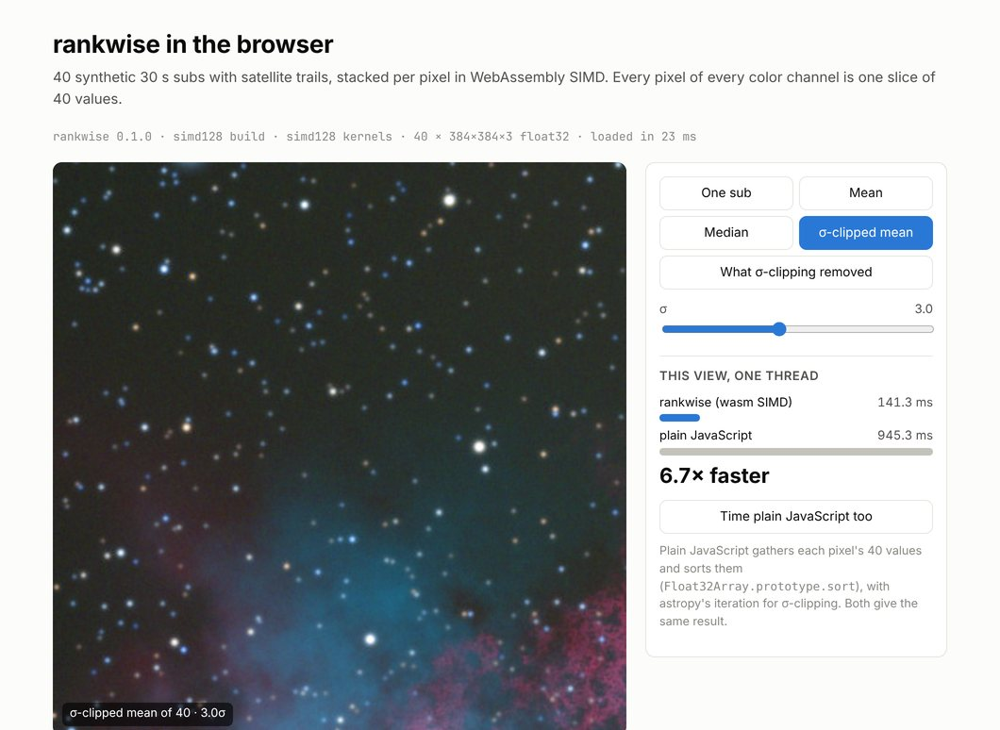
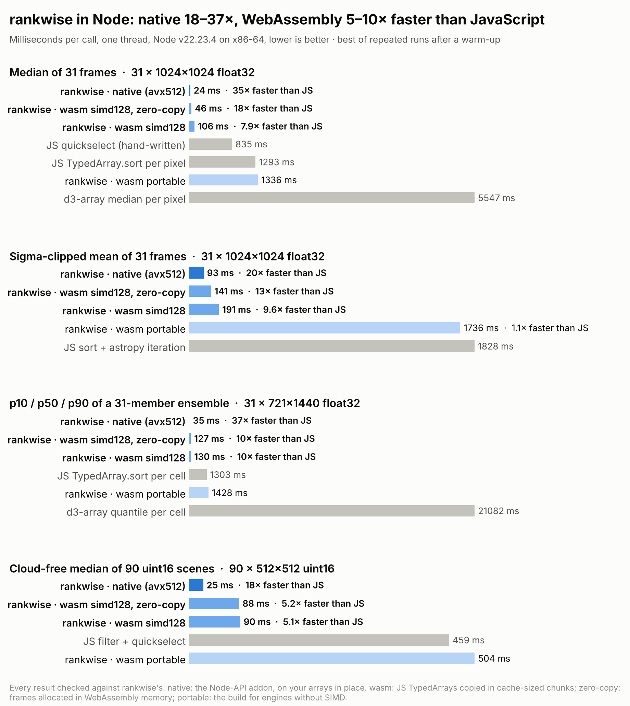

# rankwise in JavaScript

`rankwise-js/` is the `rankwise` npm package. It is the Python package's API on TypedArrays,
with two backends behind it:

* **Native**, in Node, Bun and Deno: a Node-API addon (napi-rs) built from the same crate as the
  Rust, C and Python libraries. It runs AVX-512, AVX2 or NEON and `threads`, on the caller's
  arrays in place.
* **WebAssembly**, everywhere else and as the fallback: the core compiled for a 128-bit
  `simd128` vector type (4 float32, 2 float64 or 8 uint16 lanes), plus a portable build.

Results are identical across backends, and to NumPy's, SciPy's and astropy's. How the backend is
chosen, and how to see and override the choice, is in
[the package README](../rankwise-js/README.md#backends-native-or-webassembly).

<code>examples/js/browser/</code> stacking the website's 40 subs (384×384 RGB) in Chromium with WebAssembly.

## Benchmarks

One thread, 1024×1024-scale versions of the native benchmarks' workloads, on the same 2.1 GHz Xeon
cloud VM as [benchmarks.md](benchmarks.md), pinned to one core (`taskset -c 1`). Times are the best
of repeated runs after a warm-up (7 for rankwise, 2 for JavaScript). Every competitor's output is
checked against rankwise's: identical values, or for clipping identical reject counts and means.
The JavaScript baselines gather each pixel's values into a TypedArray and then use
`TypedArray.prototype.sort`, a hand-written quickselect, or d3-array's `median`/`quantile`. For
sigma clipping they sort and then run astropy's iteration.

<picture>
  <source media="(prefers-color-scheme: dark)" srcset="img/bench_js_dark.png">
  
</picture>

| Workload | Node 22: native | Node 22: WebAssembly | Bun 1.4: native | Bun 1.4: WebAssembly |
|---|---|---|---|---|
| Median, 31 × 1024² float32 | 24 ms, **35×** | 106 ms (46 zero-copy), 7.9× | 16 ms, **46×** | 66 ms, 11× |
| Sigma-clipped mean, 31 × 1024² | 93 ms, **20×** | 191 ms (141), 9.6× | 62 ms, **20×** | 169 ms, 7.2× |
| p10/p50/p90, 31 × 721×1440 | 35 ms, **37×** | 130 ms (127), 10× | 28 ms, **39×** | 91 ms, 12× |
| Median, 90 × 512² uint16, 65% nodata | 25 ms, **18×** | 90 ms (88), 5.1× | 20 ms, **23×** | 40 ms, 12× |

Each speedup is against the fastest JavaScript baseline for that workload on the same runtime.
WebAssembly times in parentheses are for frames allocated in WebAssembly memory (`rw.alloc`),
which skips the copy in. d3-array is 6–16× slower than the hand-written baselines: it takes
generic iterables. Full tables, including stack depths 4 to 511 for all three backends:
`bench/results/js_node.log` and `js_bun.log`. This VM is noisy: an earlier run measured
WebAssembly's streamed median at 75 ms and its sigma clip at 163 ms.

**The addon runs at the Rust library's speed.** On byte-identical data (`quickbench`'s, one
core), the Rust library's AVX-512 median took 15 ms and sigma clip 45 ms; the addon took 16 ms
and 48 ms (`bench/results/js_native_ref.log`). WebAssembly's 128-bit vectors run about 2.5×
slower than AVX-512 natively, about the speed of the native portable build. Copying from JS
arrays costs more on top of that. Across runs it added 10–35% to sigma clipping, and 50–130% to a
median, which reads each value only once.

The **portable** WebAssembly build, for engines without SIMD (Safari before 16.4, Node before
16.4), runs about as fast as plain JavaScript. It exists for correctness, not speed. Giving it
unrolled networks made it slower and 4× larger.

**Threads.** Natively, `{ threads: 4 }` splits a call across cores. In WebAssembly, one instance
per `worker_thread`, each reducing a strip of pixels of frames in SharedArrayBuffers, ran 3–4×
faster on 4 cores (`examples/js/node-parallel.mjs` shows both).

**Startup.** Loading the addon is a `require`. Loading and compiling a WebAssembly module takes
15–45 ms (1.5 MB, 400 KB gzipped). In WebAssembly the first few calls run while V8 or JavaScriptCore
is still optimizing the kernels, and take up to about twice as long as later ones.

Reproduce: `node rankwise-js/scripts/build.mjs --all`, `cd rankwise-js && npm install`, then
`taskset -c 1 node bench/bench.mjs --json ../bench/results/js_node.json` (and with `bun`), then
`python bench/figures.py`. `--quick` runs small sizes in a few seconds.

## How the native addon is built

* **One crate, two front ends.** `rankwise-js/src/request.rs` parses the request format both
  backends share: one Float64Array with op, layout, addresses, outputs and options. `wasm.rs`
  exports it over linear memory; `node.rs` (`--features node`, napi-rs) exports it to Node-API.
  The JS layer (`js/core.js`) builds requests the same way for both. Only the engines differ:
  `js/wasm.js` copies and streams, `js/native.js` passes arrays in place.
* **Segmented addresses, bounds-checked.** Natively a request names memory as `(i + 1) · 2^40 +
  byte offset` into the i-th array passed with it. Before any kernel runs, the addon computes
  the byte range each frame, output and mask touches from its shape and strides, and checks it
  against that array's length. A wrong request returns an error and writes nothing. A JS bug
  can't corrupt a server's memory; `test/api.test.mjs` sends out-of-range requests to show it.
* **Zero copies.** napi-rs's borrowed `Float64ArraySlice` and `Uint8ArraySlice` give the
  addon the arrays' memory for the duration of the call. Only uint8 input is widened, once.
* **Threads** come from rayon, as in the Python wheel.
* **Packaging.** `js/platforms.js` names five platforms: linux x64/arm64 glibc, macOS
  arm64/x64, Windows x64. `scripts/build.mjs --native` lays out `npm/<platform>/` as that
  platform's package (`os`, `cpu`, `libc`). `scripts/pack.mjs` packs them and the main package,
  adding the platform packages to a staged copy of its `package.json` as `optionalDependencies`.
  The repository's own `package.json` never lists them: while the `@rankwise` scope is
  unregistered, anyone could publish those names, and every `npm install` in a checkout would
  fetch them. `.github/workflows/npm.yml` builds every platform and packs the release.
* **Debug builds** of the addon need more than Node's 8 MB main-thread stack, because the
  kernels are unoptimized. The build script always builds release.

## How the WebAssembly build is built

* **One generic kernel, one more ISA.** `rankwise/src/simd/wasm.rs` implements the `Vector`
  trait with `core::arch::wasm32` intrinsics. `min`/`max` are `pmin`/`pmax` with swapped
  operands, which is exactly x86's `minps`/`maxps`: ties, ±0 and NaN behave as on x86 on every
  host, and V8 compiles them to those instructions on x86-64.
* **Two builds.** WebAssembly has no runtime feature detection, so `simd128` is a
  compile-time feature. `scripts/build.mjs` builds `+simd128` and portable modules, and the
  loader validates a 30-byte module containing one SIMD instruction to pick one.
* **No wasm-bindgen.** The module exports `rw_alloc`, `rw_free`, `rw_reduce`, `rw_describe` and a
  few getters. A call is one Float64Array request in linear memory: op, layout, frame
  addresses, outputs and options, every value an exact integer or float in an f64. The JS
  layer owns NumPy's semantics (dtype rules, `q` forms, output allocation), as the Python
  package does. The module imports nothing, so the same file works in every engine.
* **Streaming.** Frame lists and axis-0 stacks are copied in 1 MiB chunks of all frames
  together, each reduced right after it is copied, so the kernel reads cache. Measured: 512 KiB
  to 4 MiB within 4% of each other, 128 KiB 20–35% slower. Frame strides in the
  scratch are padded by a cache line to avoid power-of-two aliasing. Inner-axis reductions
  copy the whole array once and pass strides.
* **Tiering.** V8 first runs WebAssembly in its baseline compiler (Liftoff) and optimizes hot
  functions in the background, but it cannot swap a running call over to the optimized code.
  Natively, the engine inlines every per-block helper into one function per ISA so the
  `#[target_feature]` applies; in WebAssembly that made a 426 KB function. TurboFan took
  seconds to optimize it, and on one core calls stayed 3–4× slow for many calls. On wasm only,
  the per-block epilogues, clipping kernels, staging, streaming and each unrolled network are
  `inline(never)`. With `simd128` module-wide, nothing is lost: the largest function is now
  64 KB, an eager optimizing compile of the module dropped from 2.3 s to 0.3 s, and median calls
  run at full speed from the second or third call. Native code is unchanged (the attributes are
  `cfg_attr`'d).
* **Unrolling.** Unrolled networks go up to 24 frames, as on NEON. With every kernel optimized
  (`node --no-liftoff`), 16, 24 and 32 were within a few percent of each other. Interpreted
  networks were 1.4× slower.
* **Threads.** WebAssembly without shared memory has no threads, so the core runs `threads` > 1
  on the calling thread. A threaded build would need `+atomics`, a nightly `build-std` and
  cross-origin isolation in browsers. One instance per worker gives the same scaling without them.

## Verification

* The core's oracle tests (`rankwise/tests/oracle.rs`, every ISA against a scalar oracle, bit for
  bit) run on `wasm32-wasip1` with `+simd128` under Node's WASI
  (`rankwise-js/scripts/wasi-run.mjs`), so the simd128 kernels are checked like AVX-512 and NEON.
* `rankwise-js/test/make_fixtures.py` writes 591 cases with NumPy 2.5.3, SciPy 1.18.1 and astropy
  8.0.2 references. They cover:
  * medians at every network shape and NaN family
  * all 13 quantile methods × every form of `q`
  * min/max and the arg-variants
  * SciPy statistics and uint16 nodata
  * sigma clipping with identical masks and counts
* `test/conformance.test.mjs` runs each case on every backend and every ISA each has, and again
  zero-copy, with caller `out`s and (WebAssembly) tiny chunks. The backends are the addon
  (AVX-512, AVX2, scalar), simd128 (simd128, scalar) and portable. The result was 8,154 checks,
  all identical, on each of Node 22.23, Bun 1.4.4 and Deno 2.9.6. Chromium 153
  (`test/browser.mjs`) ran 5,239, the WebAssembly ones.
* `test/api.test.mjs` covers backend selection (one process per scenario: auto, option,
  environment, missing addon, invalid backend, `initSync`) and the addon's bounds checks. It also
  covers errors, memory growth, ImageData input, ISA control and threads on both backends.
* `test/package.test.mjs` serves the release from a local npm registry and installs it:
  * npm and bun each install exactly one addon package, matching the machine; the test checks
    each other platform with `--os`/`--cpu`/`--libc`.
  * Node and Bun then run it natively.
  * `--omit=optional` runs WebAssembly and reports why.
  * An esbuild browser bundle contains no native loader.
* CI runs all of this. A matrix job builds and tests the addon on arm64 Linux, macOS and Windows.
* Not tested here: Firefox and Safari. The addon has only been run on x86-64 Linux; the other
  platforms are tested in CI.

JS-specific differences from NumPy are listed in
[conformance.md](conformance.md#webassembly-and-javascript).
