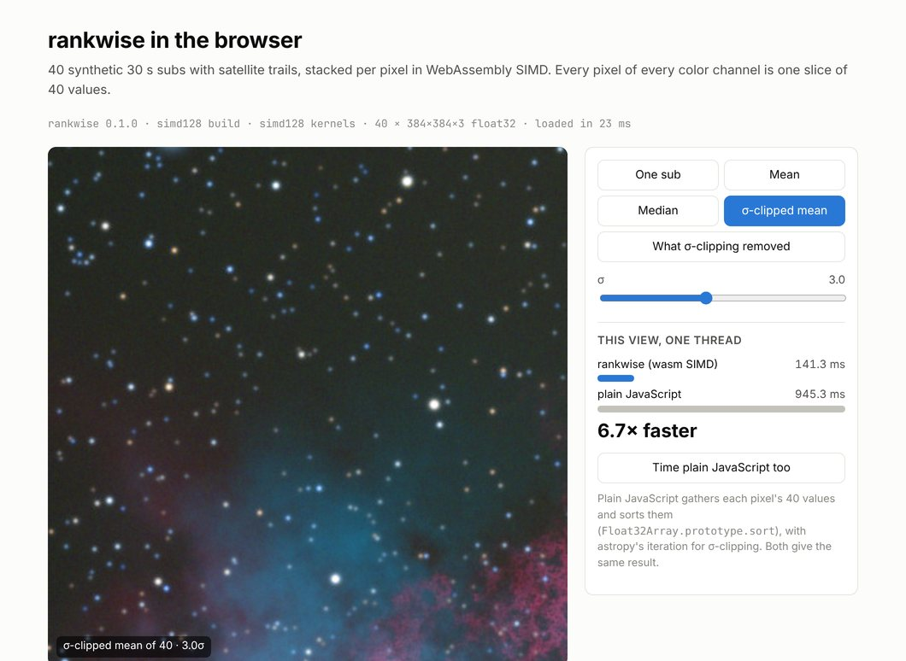
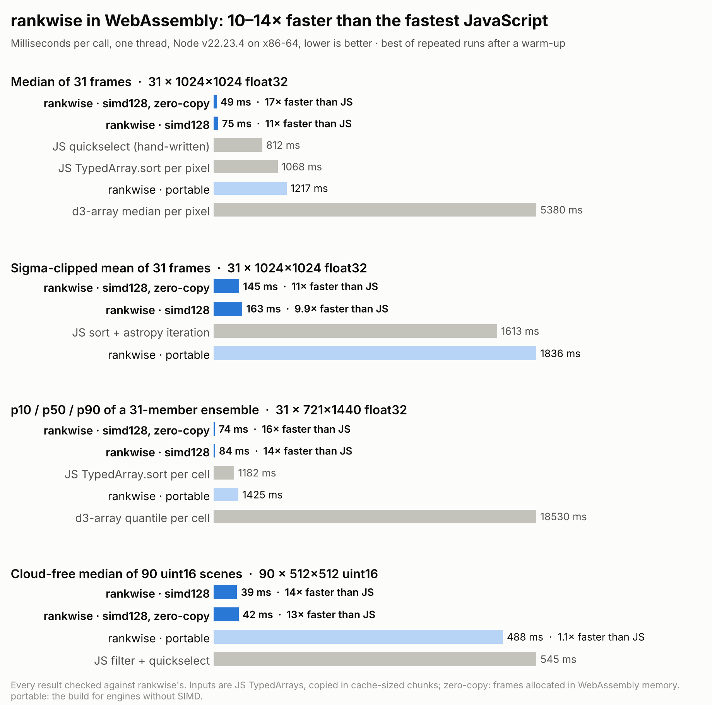

# rankwise in WebAssembly

`rankwise-wasm/` compiles the core crate to WebAssembly and wraps it in an ES module for
Node, Bun, Deno and browsers. The kernels are the same generic code as the native ones,
built for a 128-bit `simd128` vector type (4 float32, 2 float64 or 8 uint16 lanes). Results
are identical to the native library's, and so to NumPy's, SciPy's and astropy's.
[The package README](../rankwise-wasm/README.md) documents the API.

<code>examples/js/browser/</code> stacking the website's 40 subs (384×384 RGB) in Chromium.

## Benchmarks

One thread, 1024×1024-scale versions of the native benchmarks' workloads, on the same 2.1 GHz Xeon
cloud VM as [benchmarks.md](benchmarks.md), pinned to one core (`taskset -c 1`). Times are the best
of repeated runs after a warm-up (7 for rankwise, 2 for JavaScript). Every competitor's output is
checked against rankwise's: identical values, or for clipping identical reject counts and means.
The JavaScript baselines gather each pixel's values into a TypedArray and then use
`TypedArray.prototype.sort`, a hand-written quickselect, or d3-array's `median`/`quantile`. For
sigma clipping they sort and then run astropy's iteration.

<picture>
  <source media="(prefers-color-scheme: dark)" srcset="img/bench_wasm_dark.png">
  
</picture>

| Workload | Node 22 (V8) | Bun 1.4 (JavaScriptCore) |
|---|---|---|
| Median, 31 × 1024² float32 | 75 ms (49 zero-copy) vs 812 ms quickselect: **11×** | 74 ms (50) vs 617 ms: **8.4×** |
| Sigma-clipped mean, 31 × 1024², astropy's decisions | 163 ms (145) vs 1613 ms: **9.9×** | 180 ms (195) vs 1187 ms: **6.6×** |
| p10/p50/p90, 31 × 721×1440 float32 | 84 ms (74) vs 1182 ms sort: **14×** | 158 ms (100) vs 989 ms: **6.2×** |
| Median, 90 × 512² uint16, 65% nodata | 39 ms (42) vs 545 ms filter + quickselect: **14×** | 74 ms (72) vs 402 ms: **5.4×** |

Times in parentheses are for frames allocated in WebAssembly memory (`rw.alloc`), which skips
the copy in. d3-array is 6–16× slower than the hand-written baselines: it takes generic iterables.
By stack depth (median, 32M values, Node), rankwise is 5.7× faster at 4 frames, peaks at 16× at
31, and is 4.7× faster at 511, the deepest stack v0.1 takes (full table:
`bench/results/wasm_node.log`).

**Against native code**, on the same core (`cargo run --release --example quickbench -- 31 1024`):

| 31 × 1024² float32 | AVX-512 | AVX2 | native portable (SSE2) | wasm simd128, zero-copy | wasm simd128 |
|---|---|---|---|---|---|
| median | 20 ms | 23 ms | 60 ms | 49 ms | 75 ms |
| sigma-clipped mean | 45 ms | 97 ms | 127 ms | 145 ms | 163 ms |

WebAssembly's 128-bit vectors run the median at about the native portable build's speed: 2.5×
slower than AVX-512, 2.1× slower than AVX2. Copying from JS arrays adds about 50% for a median,
which reads each value once, and about 10% for sigma clipping.

The **portable** WebAssembly build, for engines without SIMD (Safari before 16.4, Node before
16.4), runs about as fast as plain JavaScript. It exists for correctness, not speed. Giving it
unrolled networks made it slower and 4× larger.

**Threads.** One instance per `worker_thread`, each reducing a strip of pixels of frames in
SharedArrayBuffers, ran 3–4× faster on 4 cores (`examples/js/node-parallel.mjs`).

**Startup.** Loading and compiling a module takes 15–45 ms (1.5 MB, 400 KB gzipped). The first
few calls run while V8 or JavaScriptCore is still optimizing the kernels and take up to about
twice as long as later ones (median of 31 × 1024²: about 95 ms, then 65–75 ms).

Reproduce: `node rankwise-wasm/scripts/build.mjs`, `cd rankwise-wasm && npm install`, then
`taskset -c 1 node bench/bench.mjs --json ../bench/results/wasm_node.json` (and with `bun`),
then `python bench/figures.py`. `--quick` runs small sizes in a few seconds.

## How it is built

* **One generic kernel, one more ISA.** `rankwise/src/simd/wasm.rs` implements the `Vector`
  trait with `core::arch::wasm32` intrinsics. `min`/`max` are `pmin`/`pmax` with swapped
  operands, which is exactly x86's `minps`/`maxps`: ties, ±0 and NaN behave as on x86 on every
  host, and V8 compiles them to those instructions on x86-64.
* **Two builds.** WebAssembly has no runtime feature detection, so `simd128` is a
  compile-time feature. `scripts/build.mjs` builds `+simd128` and portable modules, and the
  loader validates a 30-byte module containing one SIMD instruction to pick one.
* **No wasm-bindgen.** The module exports `rw_alloc`, `rw_free`, `rw_reduce`, `rw_describe` and a
  few getters. A call is one Float64Array request in linear memory: op, layout, frame
  addresses, outputs and options, every value an exact integer or float in an f64. The JS
  layer owns NumPy's semantics (dtype rules, `q` forms, output allocation), as the Python
  package does. The module imports nothing, so the same file works in every engine.
* **Streaming.** Frame lists and axis-0 stacks are copied in 1 MiB chunks of all frames
  together, each reduced right after it is copied, so the kernel reads cache. Measured: 512 KiB
  to 4 MiB within 4% of each other, 128 KiB 20–35% slower. Frame strides in the
  scratch are padded by a cache line to avoid power-of-two aliasing. Inner-axis reductions
  copy the whole array once and pass strides.
* **Tiering.** V8 first runs WebAssembly in its baseline compiler (Liftoff) and optimizes hot
  functions in the background, but it cannot swap a running call over to the optimized code.
  Natively, the engine inlines every per-block helper into one function per ISA so the
  `#[target_feature]` applies; in WebAssembly that made a 426 KB function. TurboFan took
  seconds to optimize it, and on one core calls stayed 3–4× slow for many calls. On wasm only,
  the per-block epilogues, clipping kernels, staging, streaming and each unrolled network are
  `inline(never)`. With `simd128` module-wide, nothing is lost: the largest function is now
  64 KB, an eager optimizing compile of the module dropped from 2.3 s to 0.3 s, and median calls
  run at full speed from the second or third call. Native code is unchanged (the attributes are
  `cfg_attr`'d).
* **Unrolling.** Unrolled networks go up to 24 frames, as on NEON. With every kernel optimized
  (`node --no-liftoff`), 16, 24 and 32 were within a few percent of each other. Interpreted
  networks were 1.4× slower.
* **Threads.** WebAssembly without shared memory has no threads, so the core runs `threads` > 1
  on the calling thread. A threaded build would need `+atomics`, a nightly `build-std` and
  cross-origin isolation in browsers. One instance per worker gives the same scaling without them.

## Verification

* The core's oracle tests (`rankwise/tests/oracle.rs`, every ISA against a scalar oracle, bit for
  bit) run on `wasm32-wasip1` with `+simd128` under Node's WASI
  (`rankwise-wasm/scripts/wasi-run.mjs`), so the simd128 kernels are checked like AVX-512 and NEON.
* `rankwise-wasm/test/make_fixtures.py` writes 591 cases with NumPy 2.5.3, SciPy 1.18.1 and
  astropy 8.0.2 references: medians at every network shape and NaN family, all 13 quantile
  methods × every form of `q`, min/max/arg-variants, SciPy statistics, uint16 nodata, and
  sigma clipping with identical masks and counts. `test/conformance.test.mjs` runs each case on
  both builds and every ISA, and again zero-copy, with tiny chunks and with caller `out`s:
  5,239 checks, all identical on Node 22.23, Bun 1.4.4, Deno 2.9.6 and Chromium 153
  (`test/browser.mjs`). `test/api.test.mjs` covers loading, errors, memory growth, ImageData and
  ISA control. CI runs all of this, plus the examples and a quick benchmark.
* Not tested here: Firefox, Safari, and arm64 hosts. WebAssembly's semantics make results
  deterministic across engines and hosts, but speed will differ.

JS-specific differences from NumPy are listed in
[conformance.md](conformance.md#webassembly-and-javascript).
